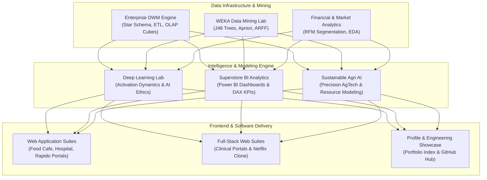

<div align="center">


[](https://github.com/akashvenkey)
[-4F46E5?style=for-the-badge&logo=academia&logoColor=white)](https://github.com/akashvenkey)
[](https://www.alliance.edu.in/)
[](https://github.com/akashvenkey)
[](#)

</div>

---

## 📌 Executive Summary & Overview

Welcome to the **Engineering Hub** repository of **Akash V** (`akashvenkey`), a software engineer and Bachelor of Computer Applications (Honors) scholar at **Alliance University**, Bangalore. 

This repository serves as an open-source technical index and portfolio hub, highlighting end-to-end software engineering capabilities spanning **Deep Learning & Neural Networks**, **Enterprise Business Intelligence**, **Full-Stack Web Development**, and **Data Warehousing & Data Mining**. Designed to meet recruiter-ready standards, each domain showcases rigorous architectural foundations, reproducible implementations, clean code modularity, and high technical credibility.

---

## 📑 Interactive Table of Contents

- [📌 Executive Summary & Overview](#-executive-summary--overview)
- [✨ Core Engineering Disciplines](#-core-engineering-disciplines)
- [🏗 System Architecture & Repository Ecosystem](#-system-architecture--repository-ecosystem)
- [🛠 Comprehensive Tech Stack Breakdown](#-comprehensive-tech-stack-breakdown)
- [🚀 Reproducible Quickstart & Navigation](#-reproducible-quickstart--navigation)
- [📂 Project Directory Layout & Repository Index](#-project-directory-layout--repository-index)
- [👨‍💻 Author & Contributions](#-author--contributions)

---

## ✨ Core Engineering Disciplines

- **🧠 Deep Learning & Mathematical Modeling:** Empirical evaluation of non-linear activation mechanics (Sigmoid, ReLU, Tanh) with NumPy and Matplotlib, paired with research on AI ethics and entertainment systems.
- **📊 Enterprise Business Analytics & Power BI:** Multi-page executive dashboards analyzing 9,994 transactional records from the Superstore dataset, complete with custom DAX KPI engines and discount elasticity models.
- **🌱 Sustainable Computing & AgTech:** Academic research on IoT telemetry, drone remote sensing, and precision machine learning models for resource optimization in agriculture.
- **🌐 Full-Stack Web Development:** Production-ready web applications built with pure HTML5 and modern CSS3, featuring healthcare management directories, streaming UI clones, and urban mobility interfaces.
- **⛏ Data Warehousing & OLAP Systems:** Star and snowflake schema design, multidimensional OLAP hypercubes, ETL pipeline automation, and WEKA data mining benchmarks.

---

## 🏗 System Architecture & Repository Ecosystem

The following diagram maps the integration of technical domains across my GitHub ecosystem:



---

## 🛠 Comprehensive Tech Stack Breakdown

| Domain | Languages & Tools | Core Capabilities |
| :--- | :--- | :--- |
| **Artificial Intelligence** | Python, NumPy, Matplotlib, Jupyter | Activation functions, continuous plotting, ethics in AI |
| **Business Intelligence** | Microsoft Power BI, DAX, Power Query | Sales and profit modeling, regional analysis, KPI dashboards |
| **Web Engineering** | HTML5, CSS3, JavaScript (ES6+) | Semantic markup, responsive layouts, client-side validation |
| **Data Warehousing** | SQL, Star/Snowflake Schema, OLAP | Multidimensional hypercubes, ETL pipelines, retail analysis |
| **Machine Learning** | WEKA Workbench, Java, ARFF | Supervised classification, k-Means clustering, Apriori rules |
| **Development Tools** | Git, GitHub, VS Code, PowerShell | Version control, documentation, command-line automation |

---

## 🚀 Reproducible Quickstart & Navigation

### Prerequisites
- Modern Web Browser (Chrome, Firefox, Edge)
- Python 3.9+ and Git installed locally

### Clone & Explore Repositories
```bash
# Clone this engineering hub
git clone https://github.com/akashvenkey/Akash-v.git

# Navigate into the project folder
cd Akash-v

# Clone and explore key companion repositories
git clone https://github.com/akashvenkey/Deep-Learning-.git
git clone https://github.com/akashvenkey/Business-Analytics.3.git
git clone https://github.com/akashvenkey/projects.git
```

---

## 📂 Project Directory Layout & Repository Index

```plaintext
Akash-v/
├── README.md               # Central engineering showcase and repository index
└── assets/                 # Architecture schematics, badges, and project media
```

### Complete Portfolio Repositories Index

| Repository | Domain | Tech Stack | Highlights |
| :--- | :--- | :--- | :--- |
| [`Akash-venktesh`](https://github.com/akashvenkey/Akash-venktesh) | Profile Portfolio | Markdown, SVG, Mermaid | Central developer showcase & bio |
| [`Deep-Learning-`](https://github.com/akashvenkey/Deep-Learning-) | Deep Learning | Python, NumPy, Matplotlib | Mathematical activation functions & AI ethics |
| [`Business-Analytics.3`](https://github.com/akashvenkey/Business-Analytics.3) | Business Intelligence | Power BI, DAX, Power Query | Superstore retail performance dashboards |
| [`Artificial-intelligence`](https://github.com/akashvenkey/Artificial-intelligence) | Sustainable AI | AgTech, IoT, AI Research | Precision agriculture & resource conservation |
| [`project-fsd`](https://github.com/akashvenkey/project-fsd) | Full-Stack Development | HTML5, CSS3, JavaScript | Hospital management & Netflix clone |
| [`projects`](https://github.com/akashvenkey/projects) | Web Applications | HTML5, CSS3, UI/UX Design | Food Cafe, City Hospital & Rapido portals |
| [`project-`](https://github.com/akashvenkey/project-) | Data Warehousing | DWM, OLAP, Star Schema | Retail ETL and multidimensional hypercubes |
| [`WEKA`](https://github.com/akashvenkey/WEKA) | Data Mining Lab | WEKA, Java, ARFF | Decision trees, clustering & Apriori rules |
| [`Business-Analytics`](https://github.com/akashvenkey/Business-Analytics) | Data Strategy | Business Modeling, KPIs | Quantitative decision intelligence |
| [`Business-Analytics.1`](https://github.com/akashvenkey/Business-Analytics.1) | Market Analytics | RFM Scoring, EDA | Customer segmentation & price elasticity |

---

## 👨‍💻 Author & Contributions

**Akash V**  
- **GitHub:** [@akashvenkey](https://github.com/akashvenkey)  
- **Degree:** Bachelor of Computer Applications (Hons)  
- **Institution:** Department of Computer Application, Alliance University, Bengaluru  
- **Specializations:** Full-Stack Web Development, Data Analytics & Artificial Intelligence  

Constructive feedback, issues, and pull requests are welcomed. If these technical repositories assist your engineering journey, please consider leaving a ⭐!

---

<div align="center">


</div>